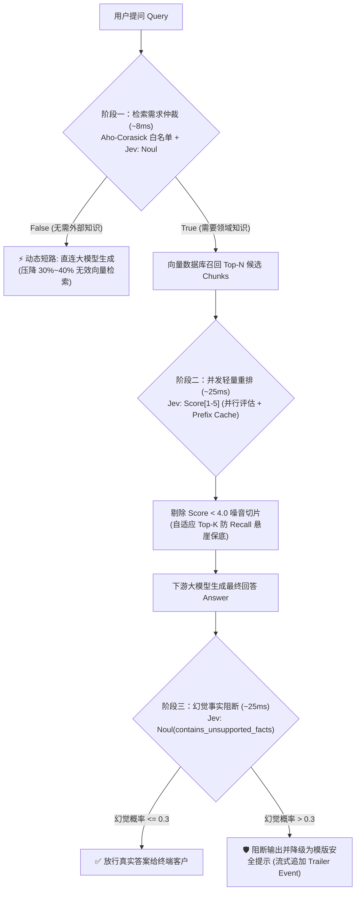

# RAG-Gatekeeper: 端侧 RAG 动态短路与防幻觉网关

[](https://github.com/jjy0230/rag-gatekeeper/actions/workflows/ci.yml)
[](https://opensource.org/licenses/MIT)
[](https://www.python.org/)

**RAG-Gatekeeper** 是一个面向企业知识库与 AI 搜索系统的超低延迟微秒级/毫秒级智能决策网关。
利用专为结构化定型决策研发的 **Jev System One 决策内核**（通过 [mode-io/vllm-jev](https://github.com/mode-io/vllm-jev) 加速服务），在检索前执行**检索需求仲裁与动态短路**，在检索后提供**毫秒级相关性重排过滤**，并在答案生成后充当**事实一致性阻断门禁**。

---

## 架构与核心数据流 (Architecture & Data Flow)



---

## 核心功能与交付成果

1. **Aho-Corasick 高速白名单匹配器 (`matcher.py`)**：
   - 纯 Python 零编译依赖实现，跨平台支持；
   - 具备 $O(N)$ 极限匹配时间复杂度，对企业数千级专有名词（SLA、部门代码、规章制度）实现 `< 0.05ms` 的微秒级规则直通。

2. **OpenAI 兼容流式/非流式反向代理 (`proxy.py`)**：
   - 拦截 `/v1/chat/completions`，即插即用兼容 **LangChain、LlamaIndex、Dify**；
   - 支持 Server-Sent Events (SSE) 流式中继，打字体验零卡顿；
   - 在流式传输末尾无缝注入 `gatekeeper_audit` 尾帧，协同前端渲染置信度与事实风险角标。

3. **防死穴双重保底机制 (`stage2_rerank.py` & `stage3_guardrail.py`)**：
   - **Anti-Recall-Cliff 保底**：当切片全低分时自适应保底保留 Top-K（默认 2 个），避免上下文脱水导致的严重拒答；
   - **前置长度硬截断**：单切片文本硬截断在 300 字符内，规避长文本 Prefill 膨胀；
   - **双轨阻断模式**：支持金融高危合规场景的 `BLOCK_AND_DEGRADE` 严格替换与人机交互的 `FLAG_ONLY` 标记。

4. **动态策略热重载与生产可观测性 (`server.py`)**：
   - 暴露 `/v1/gatekeeper/config/reload` 接口，支持动态热更阈值与白名单；
   - 原生暴露 Prometheus 格式 `/metrics` 监控端点，实时统计短路率、切片压缩比与阻断计数。

---

## 快速启动与验证 (Quick Start)

### 1. 运行测试套件（10 项测试全部通过）

```bash
# 激活环境后
pytest -v
# 或免外部依赖测试器
python tests/run_tests.py
```

### 2. 启动网关服务

```bash
uvicorn rag_gatekeeper.server:app --host 0.0.0.0 --port 8080 --reload
```

---

## 核心接口说明 (API Endpoints)

| 方法 | 端点 | 功能说明 |
| :--- | :--- | :--- |
| `GET` | `/healthz` | 探活与健康检查，返回当前模型驱动模式 |
| `GET` | `/metrics` | Prometheus 格式指标输出（短路率、评估切片数、拦截次数） |
| `POST` | `/v1/chat/completions` | OpenAI 兼容反向代理端点（支持流式 SSE 与非流式） |
| `POST` | `/v1/gatekeeper/arbitrate` | 阶段一：检索需求仲裁独立接口 |
| `POST` | `/v1/gatekeeper/rerank` | 阶段二：并发重排过滤独立接口 |
| `POST` | `/v1/gatekeeper/verify` | 阶段三：事实一致性与防幻觉核验独立接口 |
| `POST` | `/v1/gatekeeper/pipeline` | 全流程串联编排接口 |
| `POST` | `/v1/gatekeeper/config/reload` | 策略与白名单动态热更新 |

---

## License

MIT License. See [LICENSE](LICENSE) for details.
