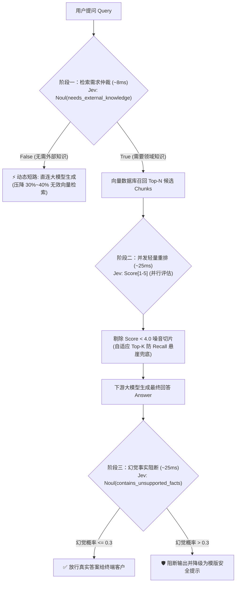

# RAG-Gatekeeper: 端侧 RAG 动态短路与防幻觉网关

[](https://github.com/jjy0230/rag-gatekeeper/actions/workflows/ci.yml)
[](https://opensource.org/licenses/MIT)
[](https://www.python.org/)

**RAG-Gatekeeper** 是一个面向企业知识库与 AI 搜索系统的超低延迟微秒级/毫秒级智能决策网关。
利用专为结构化定型决策研发的 **Jev System One 决策内核**（通过 [mode-io/vllm-jev](https://github.com/mode-io/vllm-jev) 加速服务），在检索前执行**检索需求仲裁与动态短路**，在检索后提供**毫秒级相关性重排过滤**，并在答案生成后充当**事实一致性阻断门禁**。

---

## 架构与核心数据流 (Architecture & Data Flow)



---

## 三阶段核心设计与底层机制

### 阶段一：检索需求仲裁 (Retrieval Arbitration Gate)
- **底层机制**：调用 Jev 的 `Noul` 原语（校准二元判定）评估 `needs_external_knowledge`。对于通用闲聊（“你好”）、基础算法（“快速排序怎么写”）、常识计算（“1+1等于几”），直接短路跳过向量库。
- **冷启动与专有名词保护**：内置 `FORCE_RETRIEVAL_KEYWORDS` 白名单机制，对企业核心词（如 SLA、部门财报、审批规范等）实施微秒级规则直通。
- **量化收益**：压降 30%~40% 的向量数据库空跑算力与网络开销。

### 阶段二：轻量重排过滤 (Lightweight Reranker & Noise Filtering)
- **底层机制**：对向量库召回的候选切片使用 `asyncio.gather` 并发调用 Jev `Score[1-5]`。通过统一 Query 前缀，最大化触发 vLLM 的 **KV Prefix Caching**。
- **防死穴设计（Anti-Recall-Cliff Safeguard）**：若召回结果语义鸿沟较大，导致所有切片评分均低于 4.0，系统自动触发 `fallback_top_k`（默认保留 Top 2），防止下游 LLM 陷入“无上下文可答”的极端悬崖。
- **前置长度截断**：单切片文本强制限制在 300 字符以内，防止大上下文 Prefill 耗时上升及注意力稀释。
- **量化收益**：降低大模型输入端 50% 以上的噪音 Token 消耗，将重排开销压缩至 ~25ms。

### 阶段三：幻觉事实阻断 (Hallucination & Factuality Gatekeeper)
- **底层机制**：输入 `[Answer + Filtered_Evidence]`，调用 Jev `Noul(contains_unsupported_facts)` 进行事实蕴含校验。
- **判定策略**：当判断存在不支持事实的概率超标（`prob > 0.3`）时，立即拦截大模型原始输出，降级替换为受控的安全回复模版。
- **量化收益**：将传统 LLM-as-a-Judge 的 2~4 秒全量自回归校验压缩至 ~25ms，杜绝高危虚假信息流向生产环境。

---

## 决策内核接口解耦 (Decoupled Decision Engine)

项目对底层决策服务进行了严格的接口抽象（`DecisionEngine`），实现了**无缝解耦**：
1. **Mock 模式（默认开箱即用）**：`MockDecisionEngine` 内置了确定性的规则匹配与毫秒级延迟模拟，**无需本地部署 GPU 或任何模型服务**，即可执行全链路开发与 CI/CD 单元测试。
2. **生产 vLLM-Jev 模式**：`VllmJevClient` 严格遵循 Jev 的 `POST /v1/systemone` 接口协议，支持高性能连接池复用与异常自动降级。

---

## 快速上手 (Quick Start)

### 1. 安装环境

```bash
git clone https://github.com/jjy0230/rag-gatekeeper.git
cd rag-gatekeeper
python -m venv .venv
source .venv/bin/activate  # Windows: .\.venv\Scripts\activate
pip install -r requirements.txt
```

### 2. 运行单元测试（无需任何模型服务）

```bash
pytest -v
# 或者使用纯标准库免依赖运行器
python tests/run_tests.py
```

### 3. 启动网关服务

```bash
uvicorn rag_gatekeeper.server:app --host 0.0.0.0 --port 8080 --reload
```

服务就绪后，访问 `http://localhost:8080/docs` 即可查看 Swagger OpenAPI 交互文档。

---

## 接口契约说明 (API Specification)

### 1. 阶段一：检索仲裁接口
- **Endpoint**: `POST /v1/gatekeeper/arbitrate`
- **Request**:
```json
{
  "query": "快速排序的时间复杂度是多少？"
}
```
- **Response**:
```json
{
  "needs_external_knowledge": false,
  "confidence": 0.92,
  "latency_ms": 6.8,
  "reasoning_mode": "jev_noul"
}
```

### 2. 阶段二：重排过滤接口
- **Endpoint**: `POST /v1/gatekeeper/rerank`
- **Request**:
```json
{
  "query": "差旅住宿报销标准",
  "chunks": [
    {"id": "chunk_1", "content": "核心条款：差旅每天住宿补贴上限为 450 元"},
    {"id": "chunk_2", "content": "广告与免责声明"}
  ],
  "score_threshold": 4.0
}
```
- **Response**:
```json
{
  "total_evaluated": 2,
  "kept_count": 1,
  "filtered_chunks": [
    {
      "chunk": {"id": "chunk_1", "content": "核心条款：差旅每天住宿补贴上限为 450 元"},
      "score": 4.7,
      "kept": true,
      "latency_ms": 12.3
    }
  ],
  "fallback_applied": false,
  "total_latency_ms": 22.5
}
```

### 3. 阶段三：事实一致性校验接口
- **Endpoint**: `POST /v1/gatekeeper/verify`
- **Request**:
```json
{
  "query": "公司允许带宠物上班吗？",
  "answer": "允许，并且提供猫粮补助。",
  "evidence_chunks": ["员工守则第三条：严禁私自携带宠物进入办公区域。"]
}
```
- **Response**:
```json
{
  "blocked": true,
  "hallucination_prob": 0.85,
  "final_answer": "【安全拦截】经事实一致性校验，大模型生成的回答缺乏检索文档切片的直接支撑...",
  "latency_ms": 14.1,
  "degraded": true
}
```

### 4. OpenAI 兼容代理接口
- **Endpoint**: `POST /v1/chat/completions`
- **兼容性**：无缝对接 LangChain、LlamaIndex、Dify 等现有 Agent/RAG 框架的反向代理层。

---

## 环境变量配置 (`.env` 或系统环境变量)

| 变量名 | 默认值 | 说明 |
| :--- | :--- | :--- |
| `RAG_GK_USE_MOCK_ENGINE` | `true` | 是否使用 Mock 引擎（免 GPU 开箱即用） |
| `RAG_GK_JEV_ENDPOINT` | `http://localhost:8000/v1/systemone` | mode-io/vllm-jev 服务端点 |
| `RAG_GK_JEV_MODEL_NAME` | `mode-io/vllm-jev` | Jev 底座模型名称 |
| `RAG_GK_RERANK_SCORE_THRESHOLD` | `4.0` | 阶段二切片过滤分数阈值 |
| `RAG_GK_RERANK_MAX_CHUNK_CHARS` | `300` | 切片前置截断长度保护（防 Prefill 延迟） |
| `RAG_GK_RERANK_FALLBACK_TOP_K` | `2` | 防 Recall 悬崖兜底保留切片数 |
| `RAG_GK_HALLUCINATION_PROB_THRESHOLD` | `0.3` | 阶段三幻觉阻断概率阈值 |
| `RAG_GK_GUARDRAIL_MODE` | `BLOCK_AND_DEGRADE` | 门禁模式（阻断降级 / 仅打标） |

---

## License

MIT License. See [LICENSE](LICENSE) for details.
